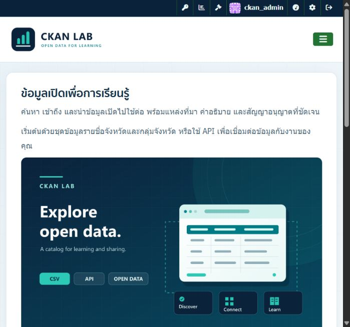

# CKAN Lab

ระบบบัญชีข้อมูลเปิดสำหรับฝึกปฏิบัติรายวิชา Data Privacy and Governance ใช้ CKAN และ Thai-GDC ผ่าน Docker Compose พร้อมข้อมูลรายชื่อจังหวัดและกลุ่มจังหวัด และตัวอย่างการเรียก CKAN Data API



## สิ่งที่ทำในโปรเจกต์

- ติดตั้ง CKAN ผ่าน Docker Compose ร่วมกับ PostgreSQL, Solr, Redis และ Nginx
- นำเข้าข้อมูลจังหวัด 76 รายการ และแสดงตารางผ่าน DataStore / XLoader
- ใช้เครื่องมือเสริม PDF View, Scheming, Hierarchy, DCAT, Thai-GDC, XLoader และ OpenD Stats
- ปรับชื่อไซต์ โลโก้ ธีมสี CSS ข้อความแนะนำ About, Footer, แบนเนอร์ พื้นหลัง และ favicon
- สาธิต Create / Read / Update / Delete ผ่าน API ด้วยข้อมูลทดสอบแยกจากข้อมูลหลัก

## โครงสร้าง

| ไฟล์หรือโฟลเดอร์ | รายละเอียด |
| --- | --- |
| `docker-compose.yml` | บริการที่ใช้รันระบบ |
| `nginx/` | Reverse proxy และกฎไม่ cache หน้าเข้าสู่ระบบ / API |
| `postgresql/` | การเตรียมฐานข้อมูล CKAN และ DataStore |
| `.env.example` | ตัวอย่างค่าตั้งสำหรับเครื่องใหม่ ไม่มีรหัสผ่านที่ใช้งานจริง |
| `assets/` | โลโก้ แบนเนอร์ พื้นหลัง favicon และ CSS |
| `data-samples/` | CSV ตัวอย่างพร้อมแหล่งที่มา |
| `examples/` | PowerShell สำหรับสาธิต CRUD และวิธีใช้ |
| `docs/` | รายละเอียดการปรับแต่งและหลักฐานการทดสอบ |

## เปิดโปรเจกต์เดิมบนเครื่องนี้

เปิด Docker Desktop แล้วเปิดโฟลเดอร์โปรเจกต์ใน VS Code จากนั้นใช้ Terminal:

```powershell
docker compose up -d
```

เปิด [CKAN Lab](http://localhost:8881/) หลังบริการเริ่มทำงาน ใช้ `.env` และ Docker volumes เดิมต่อได้ ไม่ต้องคัดลอก `.env.example` ทับ `.env` เดิม

## ติดตั้งบนเครื่องใหม่

ต้องมี Git และ Docker Desktop ที่ใช้ Linux containers

```powershell
git clone https://github.com/Homosapien666/Ckan.git
Set-Location Ckan
Copy-Item .env.example .env
```

แก้รหัสผ่านฐานข้อมูล รหัสผ่านผู้ดูแล และอีเมลใน `.env` ก่อนเริ่มระบบ โดยรหัสผ่านฐานข้อมูลของชุดติดตั้งนี้ไม่ควรมี `@` จากนั้นรัน:

```powershell
docker compose up -d --build
```

ไฟล์ใน Git เป็นโค้ด ค่าตั้งตัวอย่าง ภาพ และข้อมูลตัวอย่าง ส่วนบัญชีผู้ใช้ ชุดข้อมูล และค่าที่บันทึกผ่านหน้าเว็บอยู่ในฐานข้อมูล / Docker volumes ของแต่ละเครื่อง การ clone เพียงอย่างเดียวจึงยังไม่คืนสถานะเว็บที่เคยใช้งานทั้งหมด

ดู [การปรับแต่งเว็บไซต์](docs/customization.md), [แหล่งข้อมูล CSV](data-samples/README.md) และ [การสาธิต API](examples/README.md)

## ที่มา

ปรับจาก [ckan-docker-thai-gdc ของ NECTEC / Open-D](https://gitlab.nectec.or.th/opend/ckan-docker-thai-gdc) โดยเก็บประวัติ Git ของต้นฉบับไว้ ใช้ image `thepaeth/ckan-thai_gdc:v3.1.0` และตรวจระบบเมื่อ 27 ตุลาคม 2569 ได้ CKAN 2.10.10

ข้อมูลตัวอย่างมาจากสำนักงานคณะกรรมการพัฒนาระบบราชการ (สำนักงาน ก.พ.ร.) ดูรายละเอียดแหล่งที่มาและชื่อสัญญาอนุญาตใน `data-samples/README.md`
