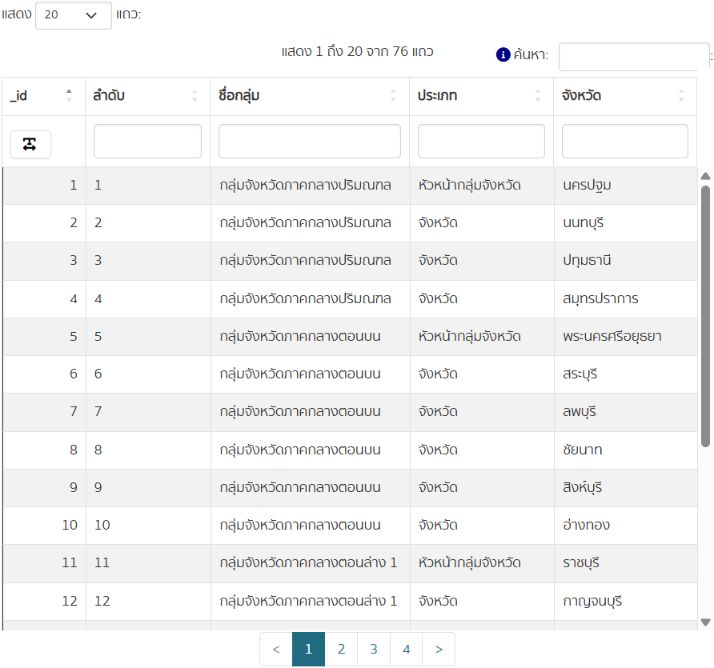

# การปรับแต่ง CKAN Lab

บันทึกการปรับแต่งสำหรับระบบ local ที่จัดทำเมื่อ 27 ตุลาคม 2569 ภาพหลักฐานแสดงสถานะในวันที่ทดสอบ

| รายการ | สิ่งที่ปรับ |
| --- | --- |
| ชื่อไซต์ | CKAN Lab |
| โลโก้ | ภาพ `assets/ckan-lab-logo.png` |
| ธีมสี | Green และ CSS โทน navy / teal / mint |
| หน้าแรก | การ์ด ปุ่ม เมนู และรูปแบบที่รองรับจอแคบ |
| ข้อความเกริ่นนำ | ข้อมูลเปิดเพื่อการเรียนรู้ |
| เกี่ยวกับระบบ | วัตถุประสงค์ของระบบและแหล่งข้อมูล |
| Footer | ข้อความระบบทดลอง ช่องทางติดต่อ และลิงก์ที่เกี่ยวข้อง |
| ลิงก์ Footer | About, GD Catalog, data.go.th, CKAN |
| แบนเนอร์ | ภาพ Explore open data |
| พื้นหลัง | ปรับผ่าน Banner Editor |
| ไอคอนเว็บไซต์ | CKAN Lab favicon |

## การตั้งค่าบนเว็บ

เข้าสู่ระบบผู้ดูแล แล้วเปิด `/ckan-admin/config` เพื่อตั้งชื่อไซต์ โลโก้ ธีม CSS ข้อความแนะนำ About และ Footer

คัดลอกเนื้อหาของ `assets/ckan-lab-theme.css` ใส่ช่อง CSS ที่กำหนดเอง โดย CSS ชุดนี้เปิดให้ภาพพื้นหลังมาจากค่า Search background ของ Banner Editor

ที่ `/ckan-admin/banner-edit` ตั้ง Promoted banner, Search background และ Site favicon ด้วย URL ของไฟล์ภาพโดยตรง ภาพใน `assets/` ต้องอัปโหลดไปยังเว็บไซต์หรือบริการที่ให้ URL ภาพก่อน ชื่อไฟล์ใน Git อย่างเดียวไม่ได้เปลี่ยนภาพในฐานข้อมูลของ CKAN

หาก Banner Editor บันทึกแล้วหน้าแรกยังใช้ภาพเก่า ให้กดบันทึกในหน้าปรับแต่งหลักอีกครั้งเพื่อรีเฟรชค่าระบบ ส่วนแพตช์การรีเฟรชอัตโนมัติที่เคยเตรียมแยกไว้ยังไม่ได้ยืนยันว่าติดตั้งแล้ว จึงไม่รวมเป็นส่วนที่ใช้งานสำเร็จใน repo นี้

## ผลทดสอบ

- ตรวจพบ CKAN 2.10.10 และ plugins ที่ใช้ในงาน
- CSV 76 แถวแสดงผลผ่าน DataStore ได้ในวันที่ตรวจ
- ผล CRUD 8 รายการอยู่ใน `api-crud-evidence.json`
- ตัวอย่างข้อมูล 5 แถวอยู่ใน `datastore-sample.json`
- ตัวอย่าง PowerShell ใน `examples/` ต้องใช้ token ของผู้ใช้เอง และใช้รหัสองค์กรของระบบ local เดิม หากติดตั้งใหม่ต้องเปลี่ยนรหัสองค์กรให้ตรงกับเครื่องนั้น

